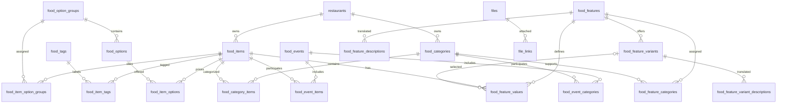

# Dashboard Nova-theme

## Required Modules
- ACL
- Admin
- Backend
- Core
- DataView
- GeneralSetting
- ActivityLog

## Setup
- Clone from gitlab laravel modules
- Then configure .env file
- run command `php artisan migrate`
- run command `composer install`
- run command `npm install`
- run command `npm run build:backend`
- run command `php artisan storage:link`
- run command `php artisan module:seed Core`

## Restaurant API Authentication

Base URL: `http://your-domain/api/restaurant`

### 1) Register restaurant account
`POST /api/restaurant/register`

Request body:
```json
{
  "restaurant_name": "My Restaurant",
  "contact_person": "John Doe",
  "email": "owner@example.com",
  "phone": "+1234567890",
  "password": "Abc@12345",
  "password_confirmation": "Abc@12345",
  "terms_accepted": true
}
```

Response example:
```json
{
  "success": true,
  "message": "Restaurant account created successfully. Please verify your email to continue.",
  "user": {
    "id": 1,
    "name": "John Doe",
    "email": "owner@example.com"
  },
  "restaurant": {
    "id": 1,
    "admin_id": 1,
    "name": "My Restaurant",
    "status": "draft",
    "approval_status": "pending",
    "onboarding_status": "draft"
  },
  "token": "1|xxxxxxxxxxxxxxxx",
  "otp_sent": true,
  "otp": 123456
}
```

### 2) Login restaurant
`POST /api/restaurant/login`

Request body:
```json
{
  "email": "owner@example.com",
  "password": "Abc@12345"
}
```

If email is verified and credentials are valid:
```json
{
  "success": true,
  "message": "Login successful.",
  "verification_required": false,
  "account_status": "approved",
  "can_onboard": true,
  "token": "1|xxxxxxxxxxxxxxxx",
  "user": {
    "id": 1,
    "name": "John Doe",
    "email": "owner@example.com"
  },
  "restaurant": {
    "id": 1,
    "name": "My Restaurant",
    "approval_status": "approved"
  }
}
```

If email is not verified:
```json
{
  "success": false,
  "verification_required": true,
  "message": "Email verification is required before accessing the restaurant dashboard.",
  "email": "owner@example.com",
  "otp_sent": true,
  "otp": 123456,
  "expires_in": 600
}
```

### 3) Send OTP
`POST /api/restaurant/auth/send-otp`

Request body (include `type`):
```json
{
    "email": "owner@example.com",
    "type": "email_verification"    // or "forgot_password"
}
```

Response:
```json
{
  "success": true,
  "message": "Verification code sent to your email.",
  "email": "owner@example.com",
  "expires_in": 600,
  "otp": 123456,
  "resend_count": 1
}
```

### 4) Resend OTP
`POST /api/restaurant/auth/resend-otp`

Request body:
```json
{
  "email": "owner@example.com"
}
```

### 5) Verify OTP
`POST /api/restaurant/auth/verify-otp`

Request body:
```json
{
  "email": "owner@example.com",
  "otp": "123456"
}
```

Response:
```json
{
  "success": true,
  "message": "Email verified successfully.",
  "verified": true,
  "restaurant": {
    "id": 1,
    "name": "My Restaurant"
  },
  "account_status": "pending"
}
```

### 5.a) Reset password using OTP
`POST /api/restaurant/auth/reset-password`

This endpoint allows resetting a restaurant owner's password using a previously sent OTP. Provide the `email`, `otp`, and the new `password` with `password_confirmation`.

Request body (form or JSON):
```json
{
    "email": "owner@example.com",
    "otp": "123456",
    "password": "NewSecurePass1",
    "password_confirmation": "NewSecurePass1"
}
```

Example curl:
```bash
curl -X POST "http://your-domain/api/restaurant/auth/reset-password" \
    -H "Content-Type: application/json" \
    -d '{"email":"owner@example.com","otp":"123456","password":"NewSecurePass1","password_confirmation":"NewSecurePass1"}'
```

Success response:
```json
{
    "success": true,
    "message": "Password updated successfully."
}
```

### 6) Get logged-in restaurant info
`GET /api/restaurant/me`

Headers:
```http
Authorization: Bearer <token>
```

### 7) Logout
`POST /api/restaurant/logout`

Headers:
```http
Authorization: Bearer <token>
```

### 8) Update restaurant (owner profile)
`POST /api/restaurant/me/update`

Headers:
```http
Authorization: Bearer <token>
Content-Type: multipart/form-data
```

Form fields (all optional except at least one):
- `name`: string
- `phone`: string (international format)
- `description`: string
- `password`: string (min 8) — requires `password_confirmation`
- `password_confirmation`: string
- `image`: file (image)

Example curl (update name and image):
```bash
curl -X POST "http://your-domain/api/restaurant/me/update" \
    -H "Authorization: Bearer <token>" \
    -F "name=My New Restaurant" \
    -F "image=@/path/to/logo.jpg"
```

Response example:
```json
{
    "success": true,
    "message": "Restaurant updated successfully.",
    "restaurant": {
        "id": 1,
        "name": "My New Restaurant",
        "admin_id": 1,
        "phone": "+1234567890",
        "description": "Updated description..."
    }
}

### 8.a) Update authenticated owner profile (name, avatar, password)
`POST /api/restaurant/me/profile`

Headers:
```http
Authorization: Bearer <token>
Content-Type: multipart/form-data
```

Form fields:
- `name` (required): string, 2-150 chars
- `image` (optional): file (jpeg, jpg, png, gif) max 2MB — will replace existing avatar
- `password` (optional): string, min 8 — requires `password_confirmation`
- `password_confirmation` (optional): string

Example curl (update name + avatar + password):
```bash
curl -X POST "http://your-domain/api/restaurant/me/profile" \
    -H "Authorization: Bearer <token>" \
    -F "name=New Owner Name" \
    -F "image=@/path/to/avatar.jpg" \
    -F "password=newpassword" \
    -F "password_confirmation=newpassword"
```

Success response example:
```json
{
    "success": true,
    "message": "Profile updated successfully.",
    "user": {
        "id": 1,
        "name": "New Owner Name",
        "email": "owner@example.com"
    }
}
```
```

### 9) Update restaurant address
`POST /api/restaurant/me/address`

Headers:
```http
Authorization: Bearer <token>
Content-Type: application/json
```

Request body (JSON):
```json
{
    "address_line1": "123 Main St",
    "address_line2": "Suite 4",
    "country_id": 1,
    "state_id": 10,
    "city_id": 100,
    "postal_code": "12345",
    "latitude": 12.345678,
    "longitude": 98.765432
}
```

Example curl:
```bash
curl -X POST "http://your-domain/api/restaurant/me/address" \
    -H "Authorization: Bearer <token>" \
    -H "Content-Type: application/json" \
    -d '{"address_line1":"123 Main St","country_id":1,"state_id":10,"city_id":100,"postal_code":"12345"}'
```

Response example:
```json
{
    "success": true,
    "message": "Address updated successfully."
}
```

### 10) Update working hours (mobile)
`POST /api/restaurant/me/hours`

Headers:
```http
Authorization: Bearer <token>
Content-Type: application/json
```

Request body (JSON):
```json
{
    "hours": {
        "monday": {"open": true, "from": "09:00", "to": "22:00"},
        "tuesday": {"open": true, "from": "09:00", "to": "22:00"},
        "wednesday": {"open": false},
        "thursday": {"open": true, "from": "09:00", "to": "22:00"},
        "friday": {"open": true, "from": "09:00", "to": "22:00"},
        "saturday": {"open": true, "from": "10:00", "to": "20:00"},
        "sunday": {"open": false}
    },
    "is_open_whole_day": false
}
```

Full-week example payload (JSON):
```json
{
    "hours": {
        "monday":   {"open": true,  "from": "09:00", "to": "22:00"},
        "tuesday":  {"open": true,  "from": "09:00", "to": "22:00"},
        "wednesday":{"open": true,  "from": "09:00", "to": "22:00"},
        "thursday": {"open": true,  "from": "09:00", "to": "22:00"},
        "friday":   {"open": true,  "from": "09:00", "to": "23:00"},
        "saturday": {"open": true,  "from": "10:00", "to": "20:00"},
        "sunday":   {"open": false, "from": null,     "to": null}
    },
    "is_open_whole_day": false
}
```

Example curl (full-week payload):
```bash
curl -X POST "http://your-domain/api/restaurant/me/hours" \
    -H "Authorization: Bearer <token>" \
    -H "Content-Type: application/json" \
    -d '{
        "hours": {
            "monday":   {"open": true,  "from": "09:00", "to": "22:00"},
            "tuesday":  {"open": true,  "from": "09:00", "to": "22:00"},
            "wednesday":{"open": true,  "from": "09:00", "to": "22:00"},
            "thursday": {"open": true,  "from": "09:00", "to": "22:00"},
            "friday":   {"open": true,  "from": "09:00", "to": "23:00"},
            "saturday": {"open": true,  "from": "10:00", "to": "20:00"},
            "sunday":   {"open": false, "from": null,     "to": null}
        },
        "is_open_whole_day": false
    }'
```

Response example:
```json
{
    "success": true,
    "message": "Working hours updated successfully."
}
```

### 11) Update holidays (mobile)
`POST /api/restaurant/me/holidays`

Headers:
```http
Authorization: Bearer <token>
Content-Type: application/json
```

Request body (JSON) — provide the full list of holidays; this replaces the existing list:
```json
{
    "holidays": [
        { "date": "2026-12-25", "reason": "Christmas Day" },
        { "date": "2027-01-01", "reason": "New Year's Day" }
    ]
}
```

Example curl:
```bash
curl -X POST "http://your-domain/api/restaurant/me/holidays" \
    -H "Authorization: Bearer <token>" \
    -H "Content-Type: application/json" \
    -d '{"holidays":[{"date":"2026-12-25","reason":"Christmas Day"},{"date":"2027-01-01","reason":"New Year"}] }'
```

Response example:
```json
{
    "success": true,
    "message": "Holidays saved successfully."
}
```

### 12) Update restaurant settings (mobile)
`POST /api/restaurant/me/settings`

Headers:
```http
Authorization: Bearer <token>
Content-Type: application/json
```

Request body (JSON):
```json
{
    "food_type": "all",                 
    "is_takeaway": true,
    "is_delivery": true,
    "is_accepting_orders": true,
    "order_time_limit": 48,
    "cancellation_time_limit": 15,
    "allow_order_cancellation": true,
    "cancellable_statuses": ["P", "O"]
}
```

Example curl:
```bash
curl -X POST "http://your-domain/api/restaurant/me/settings" \
    -H "Authorization: Bearer <token>" \
    -H "Content-Type: application/json" \
    -d '{"food_type":"all","is_takeaway":true,"is_delivery":true,"is_accepting_orders":true,"order_time_limit":48,"cancellation_time_limit":15,"allow_order_cancellation":true,"cancellable_statuses":["P","O"]}'
```

Response example:
```json
{
    "success": true,
    "message": "Settings updated successfully."
}
```

### 13) Update restaurant gallery (mobile)
`POST /api/restaurant/me/gallery`

Headers:
```http
Authorization: Bearer <token>
Content-Type: multipart/form-data
```

Form fields:
- `images[]` : array of image files (multipart). Required.

Validation rules enforced by the API:
- Maximum of 5 images per request (`images` array max: 5).
- Allowed MIME types: `jpeg`, `jpg`, `png`.
- Maximum size per file: 2 MB (2048 KB).

Example curl (upload two images):
```bash
curl -X POST "http://your-domain/api/restaurant/me/gallery" \
    -H "Authorization: Bearer <token>" \
    -F "images[]=@/path/to/food1.jpg" \
    -F "images[]=@/path/to/food2.png"
```

Successful response:
```json
{
    "success": true,
    "message": "Gallery updated successfully.",
    "restaurant_gallery": [
        { "id": 123, "url": "https://your-domain/storage/.../food1.jpg", "filename": "food1.jpg" },
        { "id": 124, "url": "https://your-domain/storage/.../food2.png", "filename": "food2.png" }
    ]
}
```

Notes:
- The endpoint appends uploaded images to the restaurant's existing gallery. Use `remove_ids` to delete specific existing images before uploading new ones.
- After upload the gallery cache is invalidated so subsequent reads return the new images.


Possible values for settings fields:

- `food_type`: one of `all`, `veg`, `non_veg`, `vegan`.
- `is_takeaway`, `is_delivery`, `is_accepting_orders`, `allow_order_cancellation`: boolean (`true` or `false`).
- `status`: one of `draft`, `active`, `inactive`.
- `order_time_limit`: integer (number of hours, e.g. `48`).
- `cancellation_time_limit`: integer (time limit, typically in minutes or hours depending on UI; default `15`).
- `cancellable_statuses`: array of order status codes allowed for customer cancellations. Example defaults used in the system: `[`"P"`, `"O"`, `"H"`]` — these map to your project's order-status codes (e.g. Pending/Processing/Handled).

Defaults (when not provided):

- `food_type`: `all`
- `is_takeaway`: `false`
- `is_delivery`: `false`
- `is_accepting_orders`: `false`
- `order_time_limit`: `48`
- `cancellation_time_limit`: `15`
- `cancellable_statuses`: `["P","O","H"]`

> Notes:
> - The API uses Sanctum authentication.
> - The OTP is sent via the notification system and is stored for verification.
> - The login flow will automatically trigger OTP sending when the restaurant email is not verified.

## Extra modules
- Countries `command: php artisan module:seed Countries`
- Currencies `command: php artisan module:seed Currencies`
- Widgets

## Want notifications?
- Notification `is Required`
- EmailNotification
- WebPushNotification

### How to setup
- Add entries of these modules in `composer.json` file and run command `composer dump-autoload`

## Commands
### New login creation
```
php artisan acl:setup --guard=vendor
```

- NOTE:: `vendor` you can replace with any name that you want to create login feature.

### First user account creation
```
php artisan user:create --guard=admin --name=test --email=admin@example.com --password=password123 --role=1
```

## Reuseable components
- Breadcrumb `add this in your view file for proper breadcrumb`
```
@section('breadcrumbs')
    @php
        $title = 'Dashboard';
        $breadcrumbs = [['label' => $title, 'url' => null]];
    @endphp

    <x-breadcrumbs :breadcrumbs="$breadcrumbs" :name="$title" />
@endsection
```

- Selector with popup
```
 <x-advanced-selector
    name="Country"  --your Field name
    table="countries" --your table name
    search-column="name" --your search column
    value-column="code" --your value column
    display-column="name" --display column
    :multiple="false" --multiple selection
    :required="false" --for required
    :selected="fn_get_setting('general.company.country') ?? []" --pass your selected values
    placeholder="Select country..." --placeholder
    label="Country" --your label
    :additional-columns="['code']" --additinal columns
    :filters="[]" --filters any
    order-by="name"
    order-direction="asc" />
```
- Global Search `just create a Listeners in your module with name of GlobalSearch.php`
```
<?php
class GlobalSearchEvent
{
    /**
     * Handle the event.
     */
    public function handle(RegisterGlobalSearch $event): void
    {
        $query = $event->query;
        $moduleFilter = $event->module;

        $event->addSearchPreference('users', 'Users');
        // add your module name
        
        if (strlen($query) < 2) {
            return;
        }

        // If module filter is set and isn't 'themes' or 'all', skip
        if ($moduleFilter !== 'all' && !in_array($moduleFilter, ['users'])) {
            return;
        }

        // Search stores by name or slug
        $stores = Currency::where('name', 'LIKE', "%{$query}%")
            ->limit(5)
            ->get();

        foreach ($stores as $s) {
            $event->addResult([
                'id' => $s->id,
                'title' => $s->name,
                'url' => 'settings/currencies?filters[code]=' . $s->code,
                'type' => 'currency',
                'module' => 'Settings',
                'module_name' => 'Currencys',
            ]);
         }
    }
}
```

- Menus
```
use Modules\Core\Events\RegisterMenu;

class RegisterMenuItems
{
    /**
     * Handle the event.
     *
     * @param  \Modules\Core\Events\RegisterMenu  $event
     * @return void
     */
    public function handle(RegisterMenu $event)
    {
        // Add default menu items
        $event->addItem([
            'label' => 'Dashboard',
            'route' => 'dashboard.index',
            'icon' => 'space_dashboard',
            'guard' => 'admin',
            'permission' => 'dashboard.index',
            'position' => 1,
        ]);
    }
}
```
- Permissions List
```
use Modules\Core\Events\RegisterPermissions;

class RegisterAdminPermissions
{
    public function handle(RegisterPermissions $event)
    {
        /**
         * Dashboard
         */
        $event->registerArray([
            'name' => 'dashboard',
            'key' => [
                'dashboard.index' => 'Access Dashboard',
            ]
        ]);
    }
}

```
- Settings Listing `to show setting options in that setting page`
```
use Modules\Core\Events\RegisterSettingsMenu;

class Settings
{
    public function handle(RegisterSettingsMenu $event): void
    {
        $event->register(
            [
                'category_code' => "access_control",
                'title' => 'Team management',
                'description' => 'Manage team members',
                'route' => route('users.index'),
                'icon' => 'admin_panel_settings',
                'permission' => 'users.index'
            ]
        );
        
    }
}

```

- NOTE:: Each componenet will be register in your EventListenerProvider controller, use from this `according to need`
```
    RegisterMenu::class => [
        RegisterMenuItems::class,
    ],
    RegisterPermissions::class => [
        RegisterAdminPermissions::class,
    ],
    RegisterSettingsMenu::class => [
        Settings::class,
    ],
    RegisterGlobalSearch::class => [
        GlobalSearchEvent::class,
    ]
```

## DataView 
- We have added a `data-view` feature so developer don't need to write every time things
- create a `DataView/DataGrid` controller in your module that table listing you want to show
- Create controller
```

use Modules\DataView\DataGrid;
use Illuminate\Support\Facades\DB;

class UsersGrid extends DataGrid
{

    protected $primaryColumn = "id";

    protected $itemsPerPage = 10;

    protected $sortOrder = 'desc';

    /**
     * Prepare query builder.
     *
     * @return \Illuminate\Database\Query\Builder
     */
    public function prepareQueryBuilder()
    {
        return DB::table('admins')
            ->select(
                'id',
                'name',
                'email',
                'status',
                'role_id',
                'created_at'
            );
    }

    /**
     * Add columns.
     *
     * @return void
     */
    public function prepareColumns()
    {
        $this->addColumn([
            'index' => 'id',
            'label' => 'ID',
            'type' => 'integer',
            'visibility' => false,
            'sortable' => true,
        ]);

        $this->addColumn([
            'index' => 'name',
            'label' => 'Name',
            'type' => 'string',
            'searchable' => true,
            'filterable' => true,
            'sortable' => true,
        ]);

        $this->addColumn([
            'index' => 'email',
            'label' => "Email",
            'type' => 'string',
            'searchable' => true,
            'filterable' => true,
            'sortable' => true,
        ]);

        $this->addColumn([
            'index' => 'status',
            'label' => 'Status',
            'type' => 'integer',
            'searchable' => false,
            'filterable' => true,
            'filterable_type' => 'dropdown',
            'allow_multiple_values' => false,
            'filterable_options' => [
                [
                    'label' => 'Active',
                    'value' => 1,
                ],
                [
                    'label' => 'Disabled',
                    'value' => 0,
                ],
            ],
            'sortable' => true,
            'closure' => function ($row) {
                return $row->status
                    ? '<span class="inline-flex items-center px-2.5 py-0.5 rounded-full text-xs font-medium bg-green-100 text-green-800">Active</span>'
                    : '<span class="inline-flex items-center px-2.5 py-0.5 rounded-full text-xs font-medium bg-red-100 text-red-800">Disable</span>';
            },
        ]);

        $roles = DB::table('roles')->pluck('name', 'id');
        $this->addColumn([
            'index' => 'role_id',
            'label' => 'Role name',
            'type' => 'integer',
            'searchable' => false,
            'filterable' => true,
            'sortable' => false,
            'closure' => function ($row) use ($roles) {
                return $roles[$row->role_id] ?? 'Unknown';
            },
            'filterable_type' => 'dropdown',
            'filterable_options' => collect($roles)->map(function ($name, $id) {
                return [
                    'label' => $name,
                    'value' => $id
                ];
            })->values()->toArray(),
        ]);

        $this->addColumn([
            'index' => 'created_at',
            'label' => 'Created At',
            'type' => 'date',
            'searchable' => true,
            'filterable' => true,
            'filterable_type' => 'date_range',
            'sortable' => true,
        ]);
    }

    /**
     * Prepare actions.
     *
     * @return void
     */
    public function prepareActions()
    {
        if (bouncer(\Illuminate\Support\Facades\Auth::getDefaultDriver())->hasPermission('users.edit')) {
            $this->addAction([
                'icon' => 'edit',
                'title' => 'Edit',
                'method' => 'GET',
                'is_popup' => true,
                'url' => function ($row) {
                    return route('users.edit', $row->id);
                },
            ]);
        }

        if (bouncer(\Illuminate\Support\Facades\Auth::getDefaultDriver())->hasPermission('users.destroy')) {
            $this->addAction([
                'icon' => 'delete',
                'title' => 'Delete',
                'method' => 'DELETE',
                'url' => function ($row) {
                    return route('users.destroy', $row->id);
                },
            ]);
        }
    }

    /**
     * Prepare mass actions.
     *
     * @return void
     */
    public function prepareMassActions()
    {
        if (bouncer(\Illuminate\Support\Facades\Auth::getDefaultDriver())->hasPermission('users.bulk-delete')) {
            $this->addMassAction([
                'icon' => 'delete',
                'title' => 'Bulk Delete',
                'method' => 'POST',
                'action' => 'text-white bg-red-600',
                'url' => 'users.bulk-delete',
            ]);
        }


        if (bouncer(\Illuminate\Support\Facades\Auth::getDefaultDriver())->hasPermission('users.toggle-status')) {
            $this->addMassAction([
                'icon' => '',
                'title' => 'Status',
                'method' => 'POST',
                'url' => 'users.toggle-status',
                'action' => 'bg-gray-500',
                'options' => [
                    [
                        'label' => 'Active',
                        'value' => 1,
                    ],
                    [
                        'label' => 'Disabled',
                        'value' => 0,
                    ],
                ],
            ]);
        }

        if (bouncer(\Illuminate\Support\Facades\Auth::getDefaultDriver())->hasPermission('users.create')) {
            $this->addMassAction([
                'icon' => 'add',
                'title' => 'Create User',
                'is_popup' => true,
                'method' => 'GET',
                'action' => 'text-white bg-blue-500',
                'url' => 'users.create',
            ]);
        }
    }
}
```
- In blade file just use this code
```
<x-data-view :data="$lists" title="" />
```


## Buttons/ Modals
- if you want modal then just use this
```
 <x-modal
    buttonText="Open Modal"
    modalTitle="Modal"
    id="my-modal"
    ajaxUrl="url"
    color="text-[var(--color-gray-800)] hover:text-[var(--color-gray-800)]/80 flex justify-center items-center"
    modalSize="2xl" />
```

## Button
```
 <x-button type="submit"                     
            class="btn-primary" 
            label="Save" 
            icon=''
            name="button" 
        />
```


### Hooks
- in general setting module under `setting/index.blade.php` file we have added some hooks.
- You can use that hooks to add any tabs, setting feild, in the general setting module
- Just you need to create `hooks` folder and then hook module name that mention in that file then create file with same name of hook.

=======
# Nova Theme

<!-- food-management-schema:start -->
## Food management database structure

Verified against the configured local database on 29 October 2026. Schema metadata only; no application records are included.

19 food management tables and 4 directly related supporting tables are documented below. The external `restaurants` table is referenced by `food_items.restaurant_id` and `food_categories.restaurant_id`.

### Table index

- [`featured_items`](#featured_items)
- [`food_categories`](#food_categories)
- [`food_category_items`](#food_category_items)
- [`food_event_categories`](#food_event_categories)
- [`food_event_items`](#food_event_items)
- [`food_events`](#food_events)
- [`food_feature_categories`](#food_feature_categories)
- [`food_feature_descriptions`](#food_feature_descriptions)
- [`food_feature_values`](#food_feature_values)
- [`food_feature_variant_descriptions`](#food_feature_variant_descriptions)
- [`food_feature_variants`](#food_feature_variants)
- [`food_features`](#food_features)
- [`food_item_option_groups`](#food_item_option_groups)
- [`food_item_options`](#food_item_options)
- [`food_item_tags`](#food_item_tags)
- [`food_items`](#food_items)
- [`food_option_groups`](#food_option_groups)
- [`food_options`](#food_options)
- [`food_tags`](#food_tags)
- [`cart_items`](#cart_items)
- [`file_links`](#file_links)
- [`files`](#files)
- [`order_items`](#order_items)

### Relationships



The diagram shows logical relationships; restaurant ownership is nullable. Exact foreign keys and deletion rules appear under each table.

### Implementation notes

- Option prices are stored in `food_item_options.price`, not in `food_options`.
- Food item images are loaded through the shared file manager using `object_type = food_image` and the food item ID as `object_id`.
- A `FoodImage` model and a conditional timestamp migration remain in the repository, but `food_images` is absent from the current database.
- Category nesting uses `food_categories.parent_id` with a foreign key. Feature grouping uses `food_features.parent_id`; the current database does not enforce a foreign key for it.
- `cart_items` and `order_items` use `item_type` / `item_id` polymorphic links. These are logical food-item relationships without a direct foreign key to `food_items`.
- `featured_items` stores its configuration in JSON `data`; it has no direct food-item foreign key.
- A default shown as “none / NULL” means metadata reports no non-null default; the Nullable column determines whether NULL is allowed.

### Food management tables

#### `featured_items`

| Column | SQL type | Nullable | Default | Extra |
|---|---|---|---|---|
| `id` | `bigint unsigned` | No | none / NULL | Auto increment |
| `data` | `json` | No | none / NULL | — |
| `status` | `tinyint(1)` | No | `1` | — |
| `created_at` | `timestamp` | Yes | none / NULL | — |
| `updated_at` | `timestamp` | Yes | none / NULL | — |

Indexes:

- INDEX `featured_items_status_created_at_index` (`status`, `created_at`).
- PRIMARY KEY `primary` (`id`).

Foreign keys:

- None enforced by the database.

#### `food_categories`

| Column | SQL type | Nullable | Default | Extra |
|---|---|---|---|---|
| `id` | `bigint unsigned` | No | none / NULL | Auto increment |
| `restaurant_id` | `bigint unsigned` | Yes | none / NULL | — |
| `parent_id` | `bigint unsigned` | Yes | none / NULL | — |
| `name` | `varchar(255)` | No | none / NULL | — |
| `slug` | `varchar(255)` | Yes | none / NULL | — |
| `description` | `text` | Yes | none / NULL | — |
| `image` | `varchar(255)` | Yes | none / NULL | — |
| `status` | `tinyint(1)` | No | `0` | — |
| `food_type` | `enum('all','veg','non_veg','vegan')` | Yes | none / NULL | — |
| `created_at` | `timestamp` | Yes | none / NULL | — |
| `updated_at` | `timestamp` | Yes | none / NULL | — |

Indexes:

- INDEX `food_categories_parent_id_index` (`parent_id`).
- INDEX `food_categories_restaurant_id_index` (`restaurant_id`).
- UNIQUE `food_categories_slug_unique` (`slug`).
- PRIMARY KEY `primary` (`id`).

Foreign keys:

- `parent_id` → `food_categories` (`id`); ON DELETE SET NULL, ON UPDATE NO ACTION.
- `restaurant_id` → `restaurants` (`id`); ON DELETE SET NULL, ON UPDATE NO ACTION.

#### `food_category_items`

| Column | SQL type | Nullable | Default | Extra |
|---|---|---|---|---|
| `id` | `bigint unsigned` | No | none / NULL | Auto increment |
| `food_item_id` | `bigint unsigned` | No | none / NULL | — |
| `food_category_id` | `bigint unsigned` | No | none / NULL | — |

Indexes:

- INDEX `food_category_items_food_category_id_foreign` (`food_category_id`).
- INDEX `food_category_items_food_item_id_foreign` (`food_item_id`).
- PRIMARY KEY `primary` (`id`).

Foreign keys:

- `food_category_id` → `food_categories` (`id`); ON DELETE CASCADE, ON UPDATE NO ACTION.
- `food_item_id` → `food_items` (`id`); ON DELETE CASCADE, ON UPDATE NO ACTION.

#### `food_event_categories`

| Column | SQL type | Nullable | Default | Extra |
|---|---|---|---|---|
| `id` | `bigint unsigned` | No | none / NULL | Auto increment |
| `food_event_id` | `bigint unsigned` | No | none / NULL | — |
| `food_category_id` | `bigint unsigned` | No | none / NULL | — |
| `created_at` | `timestamp` | Yes | none / NULL | — |
| `updated_at` | `timestamp` | Yes | none / NULL | — |

Indexes:

- INDEX `food_event_categories_food_category_id_foreign` (`food_category_id`).
- UNIQUE `food_event_categories_food_event_id_food_category_id_unique` (`food_event_id`, `food_category_id`).
- PRIMARY KEY `primary` (`id`).

Foreign keys:

- `food_category_id` → `food_categories` (`id`); ON DELETE CASCADE, ON UPDATE NO ACTION.
- `food_event_id` → `food_events` (`id`); ON DELETE CASCADE, ON UPDATE NO ACTION.

#### `food_event_items`

| Column | SQL type | Nullable | Default | Extra |
|---|---|---|---|---|
| `id` | `bigint unsigned` | No | none / NULL | Auto increment |
| `food_event_id` | `bigint unsigned` | No | none / NULL | — |
| `food_item_id` | `bigint unsigned` | No | none / NULL | — |
| `created_at` | `timestamp` | Yes | none / NULL | — |
| `updated_at` | `timestamp` | Yes | none / NULL | — |

Indexes:

- UNIQUE `food_event_items_food_event_id_food_item_id_unique` (`food_event_id`, `food_item_id`).
- INDEX `food_event_items_food_item_id_foreign` (`food_item_id`).
- PRIMARY KEY `primary` (`id`).

Foreign keys:

- `food_event_id` → `food_events` (`id`); ON DELETE CASCADE, ON UPDATE NO ACTION.
- `food_item_id` → `food_items` (`id`); ON DELETE CASCADE, ON UPDATE NO ACTION.

#### `food_events`

| Column | SQL type | Nullable | Default | Extra |
|---|---|---|---|---|
| `id` | `bigint unsigned` | No | none / NULL | Auto increment |
| `name` | `varchar(255)` | No | none / NULL | — |
| `slug` | `varchar(255)` | No | none / NULL | — |
| `description` | `text` | Yes | none / NULL | — |
| `status` | `tinyint(1)` | No | `1` | — |
| `created_at` | `timestamp` | Yes | none / NULL | — |
| `updated_at` | `timestamp` | Yes | none / NULL | — |

Indexes:

- UNIQUE `food_events_slug_unique` (`slug`).
- PRIMARY KEY `primary` (`id`).

Foreign keys:

- None enforced by the database.

#### `food_feature_categories`

| Column | SQL type | Nullable | Default | Extra |
|---|---|---|---|---|
| `feature_id` | `bigint unsigned` | No | none / NULL | — |
| `category_id` | `bigint unsigned` | No | none / NULL | — |

Indexes:

- INDEX `food_feature_categories_category_id_index` (`category_id`).
- PRIMARY KEY `primary` (`feature_id`, `category_id`).

Foreign keys:

- `category_id` → `food_categories` (`id`); ON DELETE CASCADE, ON UPDATE NO ACTION.
- `feature_id` → `food_features` (`feature_id`); ON DELETE CASCADE, ON UPDATE NO ACTION.

#### `food_feature_descriptions`

| Column | SQL type | Nullable | Default | Extra |
|---|---|---|---|---|
| `feature_id` | `bigint unsigned` | No | none / NULL | — |
| `lang_code` | `char(2)` | No | `en` | — |
| `name` | `varchar(255)` | No | empty string | — |
| `description` | `mediumtext` | Yes | none / NULL | — |

Indexes:

- INDEX `food_feature_descriptions_lang_code_index` (`lang_code`).
- PRIMARY KEY `primary` (`feature_id`, `lang_code`).

Foreign keys:

- `feature_id` → `food_features` (`feature_id`); ON DELETE CASCADE, ON UPDATE NO ACTION.

#### `food_feature_values`

| Column | SQL type | Nullable | Default | Extra |
|---|---|---|---|---|
| `id` | `bigint unsigned` | No | none / NULL | Auto increment |
| `feature_id` | `bigint unsigned` | No | none / NULL | — |
| `food_item_id` | `bigint unsigned` | No | none / NULL | — |
| `variant_id` | `bigint unsigned` | Yes | none / NULL | — |
| `value` | `varchar(255)` | No | empty string | — |
| `value_int` | `decimal(12,2)` | Yes | none / NULL | — |
| `lang_code` | `char(2)` | No | `en` | — |

Indexes:

- INDEX `food_feature_values_feature_id_lang_code_index` (`feature_id`, `lang_code`).
- INDEX `food_feature_values_food_item_id_index` (`food_item_id`).
- INDEX `food_feature_values_variant_id_index` (`variant_id`).
- PRIMARY KEY `primary` (`id`).
- UNIQUE `uq_food_feature_values_feature_item_variant_lang` (`feature_id`, `food_item_id`, `variant_id`, `lang_code`).

Foreign keys:

- `feature_id` → `food_features` (`feature_id`); ON DELETE CASCADE, ON UPDATE NO ACTION.
- `food_item_id` → `food_items` (`id`); ON DELETE CASCADE, ON UPDATE NO ACTION.
- `variant_id` → `food_feature_variants` (`variant_id`); ON DELETE SET NULL, ON UPDATE NO ACTION.

#### `food_feature_variant_descriptions`

| Column | SQL type | Nullable | Default | Extra |
|---|---|---|---|---|
| `variant_id` | `bigint unsigned` | No | none / NULL | — |
| `lang_code` | `char(2)` | No | `en` | — |
| `description` | `varchar(255)` | No | empty string | — |

Indexes:

- INDEX `food_feature_variant_descriptions_lang_code_index` (`lang_code`).
- PRIMARY KEY `primary` (`variant_id`, `lang_code`).

Foreign keys:

- `variant_id` → `food_feature_variants` (`variant_id`); ON DELETE CASCADE, ON UPDATE NO ACTION.

#### `food_feature_variants`

| Column | SQL type | Nullable | Default | Extra |
|---|---|---|---|---|
| `variant_id` | `bigint unsigned` | No | none / NULL | Auto increment |
| `feature_id` | `bigint unsigned` | No | none / NULL | — |
| `position` | `smallint unsigned` | No | `0` | — |
| `status` | `char(1)` | No | `A` | — |
| `created_at` | `timestamp` | Yes | none / NULL | — |
| `updated_at` | `timestamp` | Yes | none / NULL | — |

Indexes:

- INDEX `food_feature_variants_feature_id_index` (`feature_id`).
- INDEX `food_feature_variants_position_index` (`position`).
- INDEX `food_feature_variants_status_index` (`status`).
- PRIMARY KEY `primary` (`variant_id`).

Foreign keys:

- `feature_id` → `food_features` (`feature_id`); ON DELETE CASCADE, ON UPDATE NO ACTION.

#### `food_features`

| Column | SQL type | Nullable | Default | Extra |
|---|---|---|---|---|
| `feature_id` | `bigint unsigned` | No | none / NULL | Auto increment |
| `feature_code` | `varchar(32)` | No | empty string | — |
| `purpose` | `varchar(32)` | No | empty string | — |
| `feature_style` | `varchar(32)` | No | empty string | — |
| `filter_style` | `varchar(32)` | No | empty string | — |
| `feature_type` | `char(1)` | No | `T` | — |
| `parent_id` | `bigint unsigned` | No | `0` | — |
| `display_on_product` | `char(1)` | No | `Y` | — |
| `display_on_catalog` | `char(1)` | No | `Y` | — |
| `display_on_header` | `char(1)` | No | `N` | — |
| `status` | `char(1)` | No | `A` | — |
| `position` | `smallint unsigned` | No | `0` | — |
| `comparison` | `char(1)` | No | `N` | — |
| `created_at` | `timestamp` | Yes | none / NULL | — |
| `updated_at` | `timestamp` | Yes | none / NULL | — |

Indexes:

- INDEX `food_features_feature_type_index` (`feature_type`).
- INDEX `food_features_parent_id_index` (`parent_id`).
- INDEX `food_features_position_index` (`position`).
- INDEX `food_features_status_index` (`status`).
- PRIMARY KEY `primary` (`feature_id`).

Foreign keys:

- None enforced by the database.

#### `food_item_option_groups`

| Column | SQL type | Nullable | Default | Extra |
|---|---|---|---|---|
| `id` | `bigint unsigned` | No | none / NULL | Auto increment |
| `food_item_id` | `bigint unsigned` | No | none / NULL | — |
| `food_option_group_id` | `bigint unsigned` | No | none / NULL | — |

Indexes:

- INDEX `food_item_option_groups_food_item_id_foreign` (`food_item_id`).
- INDEX `food_item_option_groups_food_option_group_id_foreign` (`food_option_group_id`).
- PRIMARY KEY `primary` (`id`).

Foreign keys:

- `food_item_id` → `food_items` (`id`); ON DELETE CASCADE, ON UPDATE NO ACTION.
- `food_option_group_id` → `food_option_groups` (`id`); ON DELETE CASCADE, ON UPDATE NO ACTION.

#### `food_item_options`

| Column | SQL type | Nullable | Default | Extra |
|---|---|---|---|---|
| `id` | `bigint unsigned` | No | none / NULL | Auto increment |
| `food_item_id` | `bigint unsigned` | No | none / NULL | — |
| `food_option_id` | `bigint unsigned` | No | none / NULL | — |
| `price` | `decimal(10,2)` | No | `0.00` | — |
| `created_at` | `timestamp` | Yes | none / NULL | — |
| `updated_at` | `timestamp` | Yes | none / NULL | — |

Indexes:

- INDEX `food_item_options_food_option_id_foreign` (`food_option_id`).
- PRIMARY KEY `primary` (`id`).
- UNIQUE `unique_food_item_option` (`food_item_id`, `food_option_id`).

Foreign keys:

- `food_item_id` → `food_items` (`id`); ON DELETE CASCADE, ON UPDATE NO ACTION.
- `food_option_id` → `food_options` (`id`); ON DELETE CASCADE, ON UPDATE NO ACTION.

#### `food_item_tags`

| Column | SQL type | Nullable | Default | Extra |
|---|---|---|---|---|
| `id` | `bigint unsigned` | No | none / NULL | Auto increment |
| `food_item_id` | `bigint unsigned` | No | none / NULL | — |
| `food_tag_id` | `bigint unsigned` | No | none / NULL | — |

Indexes:

- INDEX `food_item_tags_food_item_id_foreign` (`food_item_id`).
- INDEX `food_item_tags_food_tag_id_foreign` (`food_tag_id`).
- PRIMARY KEY `primary` (`id`).

Foreign keys:

- `food_item_id` → `food_items` (`id`); ON DELETE CASCADE, ON UPDATE NO ACTION.
- `food_tag_id` → `food_tags` (`id`); ON DELETE CASCADE, ON UPDATE NO ACTION.

#### `food_items`

| Column | SQL type | Nullable | Default | Extra |
|---|---|---|---|---|
| `id` | `bigint unsigned` | No | none / NULL | Auto increment |
| `restaurant_id` | `bigint unsigned` | Yes | none / NULL | — |
| `name` | `varchar(255)` | No | none / NULL | — |
| `slug` | `varchar(255)` | No | none / NULL | — |
| `description` | `text` | Yes | none / NULL | — |
| `long_description` | `longtext` | Yes | none / NULL | — |
| `sale_price` | `decimal(10,2)` | No | none / NULL | — |
| `cost_price` | `decimal(10,2)` | Yes | none / NULL | — |
| `list_price` | `decimal(10,2)` | Yes | none / NULL | — |
| `in_stock` | `tinyint(1)` | No | `1` | — |
| `quantity_type` | `enum('manual','grouping','piece')` | No | `manual` | — |
| `quantity` | `int` | Yes | none / NULL | — |
| `is_available` | `tinyint(1)` | No | `1` | — |
| `is_active` | `tinyint(1)` | No | `0` | — |
| `food_type` | `enum('veg','non_veg')` | No | `veg` | — |
| `created_at` | `timestamp` | Yes | none / NULL | — |
| `updated_at` | `timestamp` | Yes | none / NULL | — |

Indexes:

- INDEX `food_items_restaurant_id_index` (`restaurant_id`).
- UNIQUE `food_items_slug_unique` (`slug`).
- PRIMARY KEY `primary` (`id`).

Foreign keys:

- `restaurant_id` → `restaurants` (`id`); ON DELETE SET NULL, ON UPDATE NO ACTION.

#### `food_option_groups`

| Column | SQL type | Nullable | Default | Extra |
|---|---|---|---|---|
| `id` | `bigint unsigned` | No | none / NULL | Auto increment |
| `name` | `varchar(255)` | No | none / NULL | — |
| `is_required` | `tinyint(1)` | No | `0` | — |
| `min` | `int` | No | `0` | — |
| `max` | `int` | No | `1` | — |
| `created_at` | `timestamp` | Yes | none / NULL | — |
| `updated_at` | `timestamp` | Yes | none / NULL | — |

Indexes:

- PRIMARY KEY `primary` (`id`).

Foreign keys:

- None enforced by the database.

#### `food_options`

| Column | SQL type | Nullable | Default | Extra |
|---|---|---|---|---|
| `id` | `bigint unsigned` | No | none / NULL | Auto increment |
| `food_option_group_id` | `bigint unsigned` | No | none / NULL | — |
| `name` | `varchar(255)` | No | none / NULL | — |
| `is_active` | `tinyint(1)` | No | `1` | — |
| `created_at` | `timestamp` | Yes | none / NULL | — |
| `updated_at` | `timestamp` | Yes | none / NULL | — |

Indexes:

- INDEX `food_options_food_option_group_id_foreign` (`food_option_group_id`).
- PRIMARY KEY `primary` (`id`).

Foreign keys:

- `food_option_group_id` → `food_option_groups` (`id`); ON DELETE CASCADE, ON UPDATE NO ACTION.

#### `food_tags`

| Column | SQL type | Nullable | Default | Extra |
|---|---|---|---|---|
| `id` | `bigint unsigned` | No | none / NULL | Auto increment |
| `name` | `varchar(255)` | No | none / NULL | — |
| `slug` | `varchar(255)` | No | none / NULL | — |
| `created_at` | `timestamp` | Yes | none / NULL | — |
| `updated_at` | `timestamp` | Yes | none / NULL | — |

Indexes:

- UNIQUE `food_tags_slug_unique` (`slug`).
- PRIMARY KEY `primary` (`id`).

Foreign keys:

- None enforced by the database.

### Related supporting tables

#### `cart_items`

| Column | SQL type | Nullable | Default | Extra |
|---|---|---|---|---|
| `id` | `bigint unsigned` | No | none / NULL | Auto increment |
| `cart_id` | `bigint unsigned` | No | none / NULL | — |
| `item_type` | `varchar(255)` | No | none / NULL | — |
| `item_id` | `bigint unsigned` | No | none / NULL | — |
| `quantity` | `int` | No | none / NULL | — |
| `unit_price` | `decimal(10,2)` | No | none / NULL | — |
| `unit_display_price` | `decimal(10,2)` | No | none / NULL | — |
| `unit_tax_amount` | `decimal(10,2)` | No | `0.00` | — |
| `total_price` | `decimal(10,2)` | No | none / NULL | — |
| `total_display_price` | `decimal(10,2)` | No | none / NULL | — |
| `total_tax_amount` | `decimal(10,2)` | No | `0.00` | — |
| `is_tax_inclusive` | `tinyint(1)` | No | `0` | — |
| `tax_breakdown` | `json` | Yes | none / NULL | — |
| `selected_options` | `json` | Yes | none / NULL | — |
| `special_instructions` | `text` | Yes | none / NULL | — |
| `created_at` | `timestamp` | Yes | none / NULL | — |
| `updated_at` | `timestamp` | Yes | none / NULL | — |

Indexes:

- INDEX `cart_items_cart_id_item_type_item_id_index` (`cart_id`, `item_type`, `item_id`).
- INDEX `cart_items_item_type_item_id_index` (`item_type`, `item_id`).
- PRIMARY KEY `primary` (`id`).

Foreign keys:

- `cart_id` → `carts` (`id`); ON DELETE CASCADE, ON UPDATE NO ACTION.

#### `file_links`

| Column | SQL type | Nullable | Default | Extra |
|---|---|---|---|---|
| `id` | `bigint unsigned` | No | none / NULL | Auto increment |
| `file_id` | `bigint unsigned` | No | none / NULL | — |
| `object_type` | `varchar(50)` | No | none / NULL | — |
| `object_id` | `bigint unsigned` | No | none / NULL | — |
| `type` | `enum('M','A')` | No | `M` | — |
| `position` | `int unsigned` | No | `0` | — |
| `created_at` | `timestamp` | Yes | none / NULL | — |
| `updated_at` | `timestamp` | Yes | none / NULL | — |

Indexes:

- INDEX `file_links_file_id_foreign` (`file_id`).
- INDEX `file_links_object_type_object_id_index` (`object_type`, `object_id`).
- INDEX `file_links_position_index` (`position`).
- INDEX `file_links_type_index` (`type`).
- PRIMARY KEY `primary` (`id`).

Foreign keys:

- `file_id` → `files` (`id`); ON DELETE CASCADE, ON UPDATE NO ACTION.

#### `files`

| Column | SQL type | Nullable | Default | Extra |
|---|---|---|---|---|
| `id` | `bigint unsigned` | No | none / NULL | Auto increment |
| `file_name` | `varchar(120)` | No | none / NULL | — |
| `original_name` | `varchar(120)` | No | none / NULL | — |
| `mime_type` | `varchar(100)` | No | none / NULL | — |
| `extension` | `varchar(10)` | No | none / NULL | — |
| `size` | `bigint unsigned` | No | none / NULL | — |
| `path` | `varchar(160)` | No | none / NULL | — |
| `is_image` | `tinyint(1)` | No | `0` | — |
| `width` | `int unsigned` | Yes | none / NULL | — |
| `height` | `int unsigned` | Yes | none / NULL | — |
| `created_at` | `timestamp` | Yes | none / NULL | — |
| `updated_at` | `timestamp` | Yes | none / NULL | — |

Indexes:

- INDEX `files_file_name_index` (`file_name`).
- INDEX `files_is_image_index` (`is_image`).
- INDEX `files_mime_type_index` (`mime_type`).
- PRIMARY KEY `primary` (`id`).

Foreign keys:

- None enforced by the database.

#### `order_items`

| Column | SQL type | Nullable | Default | Extra |
|---|---|---|---|---|
| `id` | `bigint unsigned` | No | none / NULL | Auto increment |
| `order_id` | `bigint unsigned` | No | none / NULL | — |
| `item_type` | `varchar(255)` | No | none / NULL | — |
| `item_id` | `bigint unsigned` | No | none / NULL | — |
| `item_name` | `varchar(255)` | No | none / NULL | — |
| `sku` | `varchar(255)` | Yes | none / NULL | — |
| `price` | `decimal(10,2)` | No | none / NULL | — |
| `quantity` | `int` | No | none / NULL | — |
| `tax_rate` | `decimal(5,2)` | No | `0.00` | — |
| `selected_options` | `json` | Yes | none / NULL | — |
| `special_instructions` | `text` | Yes | none / NULL | — |
| `total_price` | `decimal(10,2)` | No | none / NULL | — |
| `created_at` | `timestamp` | Yes | none / NULL | — |
| `updated_at` | `timestamp` | Yes | none / NULL | — |
| `stock_reserved_quantity` | `int unsigned` | Yes | none / NULL | — |

Indexes:

- INDEX `order_items_item_type_item_id_index` (`item_type`, `item_id`).
- INDEX `order_items_order_id_item_type_item_id_index` (`order_id`, `item_type`, `item_id`).
- PRIMARY KEY `primary` (`id`).

Foreign keys:

- `order_id` → `orders` (`id`); ON DELETE CASCADE, ON UPDATE NO ACTION.
<!-- food-management-schema:end -->
