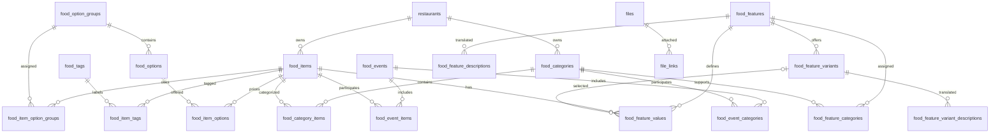

# Food management database structure

Verified against the configured local database on 29 October 2026. Schema metadata only; no application records are included.

19 food management tables and 4 directly related supporting tables are documented below. The external `restaurants` table is referenced by `food_items.restaurant_id` and `food_categories.restaurant_id`.

## Relationships

The diagram shows logical relationships; restaurant ownership is nullable. Exact foreign keys and deletion rules appear under each table.

## Implementation notes

- Option prices are stored in `food_item_options.price`, not in `food_options`.
- Food item images are loaded through the shared file manager using `object_type = food_image` and the food item ID as `object_id`.
- A `FoodImage` model and a conditional timestamp migration remain in the repository, but `food_images` is absent from the current database.
- Category nesting uses `food_categories.parent_id` with a foreign key. Feature grouping uses `food_features.parent_id`; the current database does not enforce a foreign key for it.
- `cart_items` and `order_items` use `item_type` / `item_id` polymorphic links. These are logical food-item relationships without a direct foreign key to `food_items`.
- `featured_items` stores its configuration in JSON `data`; it has no direct food-item foreign key.
- A default shown as “none / NULL” means metadata reports no non-null default; the Nullable column determines whether NULL is allowed.

## Food management tables

### `featured_items`

| Column | SQL type | Nullable | Default | Extra |
|---|---|---|---|---|
| `id` | `bigint unsigned` | No | none / NULL | Auto increment |
| `data` | `json` | No | none / NULL | — |
| `status` | `tinyint(1)` | No | `1` | — |
| `created_at` | `timestamp` | Yes | none / NULL | — |
| `updated_at` | `timestamp` | Yes | none / NULL | — |

Indexes:

- INDEX `featured_items_status_created_at_index` (`status`, `created_at`).
- PRIMARY KEY `primary` (`id`).

Foreign keys:

- None enforced by the database.

### `food_categories`

| Column | SQL type | Nullable | Default | Extra |
|---|---|---|---|---|
| `id` | `bigint unsigned` | No | none / NULL | Auto increment |
| `restaurant_id` | `bigint unsigned` | Yes | none / NULL | — |
| `parent_id` | `bigint unsigned` | Yes | none / NULL | — |
| `name` | `varchar(255)` | No | none / NULL | — |
| `slug` | `varchar(255)` | Yes | none / NULL | — |
| `description` | `text` | Yes | none / NULL | — |
| `image` | `varchar(255)` | Yes | none / NULL | — |
| `status` | `tinyint(1)` | No | `0` | — |
| `food_type` | `enum('all','veg','non_veg','vegan')` | Yes | none / NULL | — |
| `created_at` | `timestamp` | Yes | none / NULL | — |
| `updated_at` | `timestamp` | Yes | none / NULL | — |

Indexes:

- INDEX `food_categories_parent_id_index` (`parent_id`).
- INDEX `food_categories_restaurant_id_index` (`restaurant_id`).
- UNIQUE `food_categories_slug_unique` (`slug`).
- PRIMARY KEY `primary` (`id`).

Foreign keys:

- `parent_id` → `food_categories` (`id`); ON DELETE SET NULL, ON UPDATE NO ACTION.
- `restaurant_id` → `restaurants` (`id`); ON DELETE SET NULL, ON UPDATE NO ACTION.

### `food_category_items`

| Column | SQL type | Nullable | Default | Extra |
|---|---|---|---|---|
| `id` | `bigint unsigned` | No | none / NULL | Auto increment |
| `food_item_id` | `bigint unsigned` | No | none / NULL | — |
| `food_category_id` | `bigint unsigned` | No | none / NULL | — |

Indexes:

- INDEX `food_category_items_food_category_id_foreign` (`food_category_id`).
- INDEX `food_category_items_food_item_id_foreign` (`food_item_id`).
- PRIMARY KEY `primary` (`id`).

Foreign keys:

- `food_category_id` → `food_categories` (`id`); ON DELETE CASCADE, ON UPDATE NO ACTION.
- `food_item_id` → `food_items` (`id`); ON DELETE CASCADE, ON UPDATE NO ACTION.

### `food_event_categories`

| Column | SQL type | Nullable | Default | Extra |
|---|---|---|---|---|
| `id` | `bigint unsigned` | No | none / NULL | Auto increment |
| `food_event_id` | `bigint unsigned` | No | none / NULL | — |
| `food_category_id` | `bigint unsigned` | No | none / NULL | — |
| `created_at` | `timestamp` | Yes | none / NULL | — |
| `updated_at` | `timestamp` | Yes | none / NULL | — |

Indexes:

- INDEX `food_event_categories_food_category_id_foreign` (`food_category_id`).
- UNIQUE `food_event_categories_food_event_id_food_category_id_unique` (`food_event_id`, `food_category_id`).
- PRIMARY KEY `primary` (`id`).

Foreign keys:

- `food_category_id` → `food_categories` (`id`); ON DELETE CASCADE, ON UPDATE NO ACTION.
- `food_event_id` → `food_events` (`id`); ON DELETE CASCADE, ON UPDATE NO ACTION.

### `food_event_items`

| Column | SQL type | Nullable | Default | Extra |
|---|---|---|---|---|
| `id` | `bigint unsigned` | No | none / NULL | Auto increment |
| `food_event_id` | `bigint unsigned` | No | none / NULL | — |
| `food_item_id` | `bigint unsigned` | No | none / NULL | — |
| `created_at` | `timestamp` | Yes | none / NULL | — |
| `updated_at` | `timestamp` | Yes | none / NULL | — |

Indexes:

- UNIQUE `food_event_items_food_event_id_food_item_id_unique` (`food_event_id`, `food_item_id`).
- INDEX `food_event_items_food_item_id_foreign` (`food_item_id`).
- PRIMARY KEY `primary` (`id`).

Foreign keys:

- `food_event_id` → `food_events` (`id`); ON DELETE CASCADE, ON UPDATE NO ACTION.
- `food_item_id` → `food_items` (`id`); ON DELETE CASCADE, ON UPDATE NO ACTION.

### `food_events`

| Column | SQL type | Nullable | Default | Extra |
|---|---|---|---|---|
| `id` | `bigint unsigned` | No | none / NULL | Auto increment |
| `name` | `varchar(255)` | No | none / NULL | — |
| `slug` | `varchar(255)` | No | none / NULL | — |
| `description` | `text` | Yes | none / NULL | — |
| `status` | `tinyint(1)` | No | `1` | — |
| `created_at` | `timestamp` | Yes | none / NULL | — |
| `updated_at` | `timestamp` | Yes | none / NULL | — |

Indexes:

- UNIQUE `food_events_slug_unique` (`slug`).
- PRIMARY KEY `primary` (`id`).

Foreign keys:

- None enforced by the database.

### `food_feature_categories`

| Column | SQL type | Nullable | Default | Extra |
|---|---|---|---|---|
| `feature_id` | `bigint unsigned` | No | none / NULL | — |
| `category_id` | `bigint unsigned` | No | none / NULL | — |

Indexes:

- INDEX `food_feature_categories_category_id_index` (`category_id`).
- PRIMARY KEY `primary` (`feature_id`, `category_id`).

Foreign keys:

- `category_id` → `food_categories` (`id`); ON DELETE CASCADE, ON UPDATE NO ACTION.
- `feature_id` → `food_features` (`feature_id`); ON DELETE CASCADE, ON UPDATE NO ACTION.

### `food_feature_descriptions`

| Column | SQL type | Nullable | Default | Extra |
|---|---|---|---|---|
| `feature_id` | `bigint unsigned` | No | none / NULL | — |
| `lang_code` | `char(2)` | No | `en` | — |
| `name` | `varchar(255)` | No | empty string | — |
| `description` | `mediumtext` | Yes | none / NULL | — |

Indexes:

- INDEX `food_feature_descriptions_lang_code_index` (`lang_code`).
- PRIMARY KEY `primary` (`feature_id`, `lang_code`).

Foreign keys:

- `feature_id` → `food_features` (`feature_id`); ON DELETE CASCADE, ON UPDATE NO ACTION.

### `food_feature_values`

| Column | SQL type | Nullable | Default | Extra |
|---|---|---|---|---|
| `id` | `bigint unsigned` | No | none / NULL | Auto increment |
| `feature_id` | `bigint unsigned` | No | none / NULL | — |
| `food_item_id` | `bigint unsigned` | No | none / NULL | — |
| `variant_id` | `bigint unsigned` | Yes | none / NULL | — |
| `value` | `varchar(255)` | No | empty string | — |
| `value_int` | `decimal(12,2)` | Yes | none / NULL | — |
| `lang_code` | `char(2)` | No | `en` | — |

Indexes:

- INDEX `food_feature_values_feature_id_lang_code_index` (`feature_id`, `lang_code`).
- INDEX `food_feature_values_food_item_id_index` (`food_item_id`).
- INDEX `food_feature_values_variant_id_index` (`variant_id`).
- PRIMARY KEY `primary` (`id`).
- UNIQUE `uq_food_feature_values_feature_item_variant_lang` (`feature_id`, `food_item_id`, `variant_id`, `lang_code`).

Foreign keys:

- `feature_id` → `food_features` (`feature_id`); ON DELETE CASCADE, ON UPDATE NO ACTION.
- `food_item_id` → `food_items` (`id`); ON DELETE CASCADE, ON UPDATE NO ACTION.
- `variant_id` → `food_feature_variants` (`variant_id`); ON DELETE SET NULL, ON UPDATE NO ACTION.

### `food_feature_variant_descriptions`

| Column | SQL type | Nullable | Default | Extra |
|---|---|---|---|---|
| `variant_id` | `bigint unsigned` | No | none / NULL | — |
| `lang_code` | `char(2)` | No | `en` | — |
| `description` | `varchar(255)` | No | empty string | — |

Indexes:

- INDEX `food_feature_variant_descriptions_lang_code_index` (`lang_code`).
- PRIMARY KEY `primary` (`variant_id`, `lang_code`).

Foreign keys:

- `variant_id` → `food_feature_variants` (`variant_id`); ON DELETE CASCADE, ON UPDATE NO ACTION.

### `food_feature_variants`

| Column | SQL type | Nullable | Default | Extra |
|---|---|---|---|---|
| `variant_id` | `bigint unsigned` | No | none / NULL | Auto increment |
| `feature_id` | `bigint unsigned` | No | none / NULL | — |
| `position` | `smallint unsigned` | No | `0` | — |
| `status` | `char(1)` | No | `A` | — |
| `created_at` | `timestamp` | Yes | none / NULL | — |
| `updated_at` | `timestamp` | Yes | none / NULL | — |

Indexes:

- INDEX `food_feature_variants_feature_id_index` (`feature_id`).
- INDEX `food_feature_variants_position_index` (`position`).
- INDEX `food_feature_variants_status_index` (`status`).
- PRIMARY KEY `primary` (`variant_id`).

Foreign keys:

- `feature_id` → `food_features` (`feature_id`); ON DELETE CASCADE, ON UPDATE NO ACTION.

### `food_features`

| Column | SQL type | Nullable | Default | Extra |
|---|---|---|---|---|
| `feature_id` | `bigint unsigned` | No | none / NULL | Auto increment |
| `feature_code` | `varchar(32)` | No | empty string | — |
| `purpose` | `varchar(32)` | No | empty string | — |
| `feature_style` | `varchar(32)` | No | empty string | — |
| `filter_style` | `varchar(32)` | No | empty string | — |
| `feature_type` | `char(1)` | No | `T` | — |
| `parent_id` | `bigint unsigned` | No | `0` | — |
| `display_on_product` | `char(1)` | No | `Y` | — |
| `display_on_catalog` | `char(1)` | No | `Y` | — |
| `display_on_header` | `char(1)` | No | `N` | — |
| `status` | `char(1)` | No | `A` | — |
| `position` | `smallint unsigned` | No | `0` | — |
| `comparison` | `char(1)` | No | `N` | — |
| `created_at` | `timestamp` | Yes | none / NULL | — |
| `updated_at` | `timestamp` | Yes | none / NULL | — |

Indexes:

- INDEX `food_features_feature_type_index` (`feature_type`).
- INDEX `food_features_parent_id_index` (`parent_id`).
- INDEX `food_features_position_index` (`position`).
- INDEX `food_features_status_index` (`status`).
- PRIMARY KEY `primary` (`feature_id`).

Foreign keys:

- None enforced by the database.

### `food_item_option_groups`

| Column | SQL type | Nullable | Default | Extra |
|---|---|---|---|---|
| `id` | `bigint unsigned` | No | none / NULL | Auto increment |
| `food_item_id` | `bigint unsigned` | No | none / NULL | — |
| `food_option_group_id` | `bigint unsigned` | No | none / NULL | — |

Indexes:

- INDEX `food_item_option_groups_food_item_id_foreign` (`food_item_id`).
- INDEX `food_item_option_groups_food_option_group_id_foreign` (`food_option_group_id`).
- PRIMARY KEY `primary` (`id`).

Foreign keys:

- `food_item_id` → `food_items` (`id`); ON DELETE CASCADE, ON UPDATE NO ACTION.
- `food_option_group_id` → `food_option_groups` (`id`); ON DELETE CASCADE, ON UPDATE NO ACTION.

### `food_item_options`

| Column | SQL type | Nullable | Default | Extra |
|---|---|---|---|---|
| `id` | `bigint unsigned` | No | none / NULL | Auto increment |
| `food_item_id` | `bigint unsigned` | No | none / NULL | — |
| `food_option_id` | `bigint unsigned` | No | none / NULL | — |
| `price` | `decimal(10,2)` | No | `0.00` | — |
| `created_at` | `timestamp` | Yes | none / NULL | — |
| `updated_at` | `timestamp` | Yes | none / NULL | — |

Indexes:

- INDEX `food_item_options_food_option_id_foreign` (`food_option_id`).
- PRIMARY KEY `primary` (`id`).
- UNIQUE `unique_food_item_option` (`food_item_id`, `food_option_id`).

Foreign keys:

- `food_item_id` → `food_items` (`id`); ON DELETE CASCADE, ON UPDATE NO ACTION.
- `food_option_id` → `food_options` (`id`); ON DELETE CASCADE, ON UPDATE NO ACTION.

### `food_item_tags`

| Column | SQL type | Nullable | Default | Extra |
|---|---|---|---|---|
| `id` | `bigint unsigned` | No | none / NULL | Auto increment |
| `food_item_id` | `bigint unsigned` | No | none / NULL | — |
| `food_tag_id` | `bigint unsigned` | No | none / NULL | — |

Indexes:

- INDEX `food_item_tags_food_item_id_foreign` (`food_item_id`).
- INDEX `food_item_tags_food_tag_id_foreign` (`food_tag_id`).
- PRIMARY KEY `primary` (`id`).

Foreign keys:

- `food_item_id` → `food_items` (`id`); ON DELETE CASCADE, ON UPDATE NO ACTION.
- `food_tag_id` → `food_tags` (`id`); ON DELETE CASCADE, ON UPDATE NO ACTION.

### `food_items`

| Column | SQL type | Nullable | Default | Extra |
|---|---|---|---|---|
| `id` | `bigint unsigned` | No | none / NULL | Auto increment |
| `restaurant_id` | `bigint unsigned` | Yes | none / NULL | — |
| `name` | `varchar(255)` | No | none / NULL | — |
| `slug` | `varchar(255)` | No | none / NULL | — |
| `description` | `text` | Yes | none / NULL | — |
| `long_description` | `longtext` | Yes | none / NULL | — |
| `sale_price` | `decimal(10,2)` | No | none / NULL | — |
| `cost_price` | `decimal(10,2)` | Yes | none / NULL | — |
| `list_price` | `decimal(10,2)` | Yes | none / NULL | — |
| `in_stock` | `tinyint(1)` | No | `1` | — |
| `quantity_type` | `enum('manual','grouping','piece')` | No | `manual` | — |
| `quantity` | `int` | Yes | none / NULL | — |
| `is_available` | `tinyint(1)` | No | `1` | — |
| `is_active` | `tinyint(1)` | No | `0` | — |
| `food_type` | `enum('veg','non_veg')` | No | `veg` | — |
| `created_at` | `timestamp` | Yes | none / NULL | — |
| `updated_at` | `timestamp` | Yes | none / NULL | — |

Indexes:

- INDEX `food_items_restaurant_id_index` (`restaurant_id`).
- UNIQUE `food_items_slug_unique` (`slug`).
- PRIMARY KEY `primary` (`id`).

Foreign keys:

- `restaurant_id` → `restaurants` (`id`); ON DELETE SET NULL, ON UPDATE NO ACTION.

### `food_option_groups`

| Column | SQL type | Nullable | Default | Extra |
|---|---|---|---|---|
| `id` | `bigint unsigned` | No | none / NULL | Auto increment |
| `name` | `varchar(255)` | No | none / NULL | — |
| `is_required` | `tinyint(1)` | No | `0` | — |
| `min` | `int` | No | `0` | — |
| `max` | `int` | No | `1` | — |
| `created_at` | `timestamp` | Yes | none / NULL | — |
| `updated_at` | `timestamp` | Yes | none / NULL | — |

Indexes:

- PRIMARY KEY `primary` (`id`).

Foreign keys:

- None enforced by the database.

### `food_options`

| Column | SQL type | Nullable | Default | Extra |
|---|---|---|---|---|
| `id` | `bigint unsigned` | No | none / NULL | Auto increment |
| `food_option_group_id` | `bigint unsigned` | No | none / NULL | — |
| `name` | `varchar(255)` | No | none / NULL | — |
| `is_active` | `tinyint(1)` | No | `1` | — |
| `created_at` | `timestamp` | Yes | none / NULL | — |
| `updated_at` | `timestamp` | Yes | none / NULL | — |

Indexes:

- INDEX `food_options_food_option_group_id_foreign` (`food_option_group_id`).
- PRIMARY KEY `primary` (`id`).

Foreign keys:

- `food_option_group_id` → `food_option_groups` (`id`); ON DELETE CASCADE, ON UPDATE NO ACTION.

### `food_tags`

| Column | SQL type | Nullable | Default | Extra |
|---|---|---|---|---|
| `id` | `bigint unsigned` | No | none / NULL | Auto increment |
| `name` | `varchar(255)` | No | none / NULL | — |
| `slug` | `varchar(255)` | No | none / NULL | — |
| `created_at` | `timestamp` | Yes | none / NULL | — |
| `updated_at` | `timestamp` | Yes | none / NULL | — |

Indexes:

- UNIQUE `food_tags_slug_unique` (`slug`).
- PRIMARY KEY `primary` (`id`).

Foreign keys:

- None enforced by the database.

## Related supporting tables

### `cart_items`

| Column | SQL type | Nullable | Default | Extra |
|---|---|---|---|---|
| `id` | `bigint unsigned` | No | none / NULL | Auto increment |
| `cart_id` | `bigint unsigned` | No | none / NULL | — |
| `item_type` | `varchar(255)` | No | none / NULL | — |
| `item_id` | `bigint unsigned` | No | none / NULL | — |
| `quantity` | `int` | No | none / NULL | — |
| `unit_price` | `decimal(10,2)` | No | none / NULL | — |
| `unit_display_price` | `decimal(10,2)` | No | none / NULL | — |
| `unit_tax_amount` | `decimal(10,2)` | No | `0.00` | — |
| `total_price` | `decimal(10,2)` | No | none / NULL | — |
| `total_display_price` | `decimal(10,2)` | No | none / NULL | — |
| `total_tax_amount` | `decimal(10,2)` | No | `0.00` | — |
| `is_tax_inclusive` | `tinyint(1)` | No | `0` | — |
| `tax_breakdown` | `json` | Yes | none / NULL | — |
| `selected_options` | `json` | Yes | none / NULL | — |
| `special_instructions` | `text` | Yes | none / NULL | — |
| `created_at` | `timestamp` | Yes | none / NULL | — |
| `updated_at` | `timestamp` | Yes | none / NULL | — |

Indexes:

- INDEX `cart_items_cart_id_item_type_item_id_index` (`cart_id`, `item_type`, `item_id`).
- INDEX `cart_items_item_type_item_id_index` (`item_type`, `item_id`).
- PRIMARY KEY `primary` (`id`).

Foreign keys:

- `cart_id` → `carts` (`id`); ON DELETE CASCADE, ON UPDATE NO ACTION.

### `file_links`

| Column | SQL type | Nullable | Default | Extra |
|---|---|---|---|---|
| `id` | `bigint unsigned` | No | none / NULL | Auto increment |
| `file_id` | `bigint unsigned` | No | none / NULL | — |
| `object_type` | `varchar(50)` | No | none / NULL | — |
| `object_id` | `bigint unsigned` | No | none / NULL | — |
| `type` | `enum('M','A')` | No | `M` | — |
| `position` | `int unsigned` | No | `0` | — |
| `created_at` | `timestamp` | Yes | none / NULL | — |
| `updated_at` | `timestamp` | Yes | none / NULL | — |

Indexes:

- INDEX `file_links_file_id_foreign` (`file_id`).
- INDEX `file_links_object_type_object_id_index` (`object_type`, `object_id`).
- INDEX `file_links_position_index` (`position`).
- INDEX `file_links_type_index` (`type`).
- PRIMARY KEY `primary` (`id`).

Foreign keys:

- `file_id` → `files` (`id`); ON DELETE CASCADE, ON UPDATE NO ACTION.

### `files`

| Column | SQL type | Nullable | Default | Extra |
|---|---|---|---|---|
| `id` | `bigint unsigned` | No | none / NULL | Auto increment |
| `file_name` | `varchar(120)` | No | none / NULL | — |
| `original_name` | `varchar(120)` | No | none / NULL | — |
| `mime_type` | `varchar(100)` | No | none / NULL | — |
| `extension` | `varchar(10)` | No | none / NULL | — |
| `size` | `bigint unsigned` | No | none / NULL | — |
| `path` | `varchar(160)` | No | none / NULL | — |
| `is_image` | `tinyint(1)` | No | `0` | — |
| `width` | `int unsigned` | Yes | none / NULL | — |
| `height` | `int unsigned` | Yes | none / NULL | — |
| `created_at` | `timestamp` | Yes | none / NULL | — |
| `updated_at` | `timestamp` | Yes | none / NULL | — |

Indexes:

- INDEX `files_file_name_index` (`file_name`).
- INDEX `files_is_image_index` (`is_image`).
- INDEX `files_mime_type_index` (`mime_type`).
- PRIMARY KEY `primary` (`id`).

Foreign keys:

- None enforced by the database.

### `order_items`

| Column | SQL type | Nullable | Default | Extra |
|---|---|---|---|---|
| `id` | `bigint unsigned` | No | none / NULL | Auto increment |
| `order_id` | `bigint unsigned` | No | none / NULL | — |
| `item_type` | `varchar(255)` | No | none / NULL | — |
| `item_id` | `bigint unsigned` | No | none / NULL | — |
| `item_name` | `varchar(255)` | No | none / NULL | — |
| `sku` | `varchar(255)` | Yes | none / NULL | — |
| `price` | `decimal(10,2)` | No | none / NULL | — |
| `quantity` | `int` | No | none / NULL | — |
| `tax_rate` | `decimal(5,2)` | No | `0.00` | — |
| `selected_options` | `json` | Yes | none / NULL | — |
| `special_instructions` | `text` | Yes | none / NULL | — |
| `total_price` | `decimal(10,2)` | No | none / NULL | — |
| `created_at` | `timestamp` | Yes | none / NULL | — |
| `updated_at` | `timestamp` | Yes | none / NULL | — |
| `stock_reserved_quantity` | `int unsigned` | Yes | none / NULL | — |

Indexes:

- INDEX `order_items_item_type_item_id_index` (`item_type`, `item_id`).
- INDEX `order_items_order_id_item_type_item_id_index` (`order_id`, `item_type`, `item_id`).
- PRIMARY KEY `primary` (`id`).

Foreign keys:

- `order_id` → `orders` (`id`); ON DELETE CASCADE, ON UPDATE NO ACTION.
